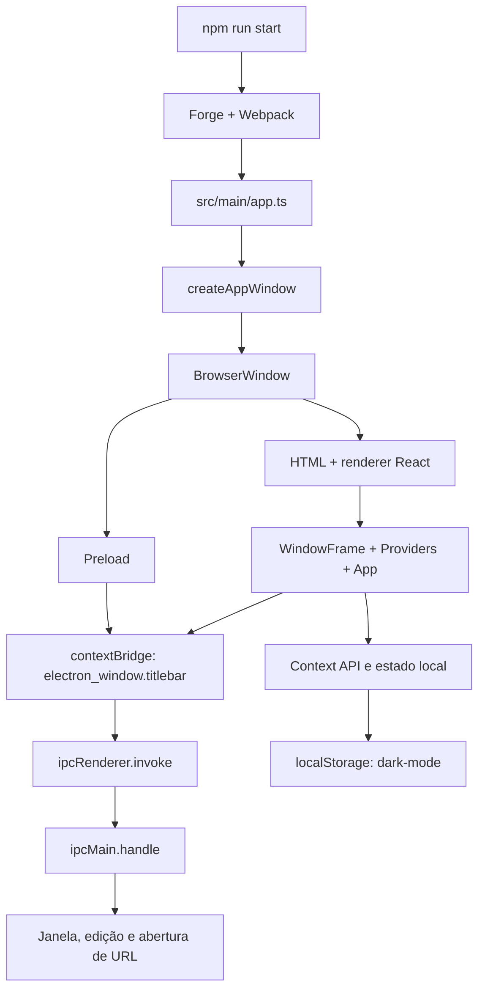

# Análise do funcionamento legado

Data: 2026-10-28. Base: `52077522486403a3d0351341c952ebb69e00b954`.
Status: análise estática da Etapa 0 aprovada, registrada na Etapa 1A.

## Conclusão e limite da evidência

O código representa uma base Electron/React com demonstração visual, tema e
controles de janela. Não foi identificada integração RabbitMQ. As funcionalidades
abaixo são implementações observadas no código, não resultados de execução.
Não foram executados aplicação, lint, compilação ou instaladores.

## Arquitetura original

## Fluxos reconstruídos

| Pergunta | Evidência e comportamento |
| --- | --- |
| 1. Como inicializa? | `package.json` aponta `main` para `.webpack/main`; Forge usa `tools/webpack/webpack.main.js`, cuja entrada é `src/main/app.ts` |
| 2. Como cria a janela? | `app.on("ready", createAppWindow)`; janela 800 × 600, sem frame, oculta até `ready-to-show` |
| 3. Como os processos se comunicam? | Renderer usa `electron_window.titlebar`; preload invoca canais registrados por `ipcMain.handle` |
| 4. Existe preload? | `src/renderer/preload.tsx` importa `misc/window/windowPreload.ts` |
| 5. Há isolamento? | `contextIsolation: true`, Node desativado no renderer/workers/subframes, mas `sandbox: false` |
| 6. Como React inicia? | `createRoot(document.getElementById("app"))` monta WindowFrame, Providers e App |
| 7. Como gerencia estado? | Hooks locais e Context API para tema e plataforma; menus também manipulam classes DOM |
| 8. Como conecta ao RabbitMQ? | Não há implementação de conexão ou cliente identificado |
| 9. Quais protocolos utiliza? | Nenhum protocolo RabbitMQ implementado; AMQP aparece como palavra-chave do manifesto |
| 10. O que está implementado? | Demonstração, tema, preferência local, menus e operações básicas da janela |
| 11. O que está incompleto? | Segurança da fronteira, multiplataforma, atalhos, erros, versão exibida e distribuição homologada |
| 12. Onde armazena configurações? | Somente `localStorage["dark-mode"]`; sem perfis ou credenciais |
| 13. Como trata erros? | Logs pontuais em console; sem estratégia de erros e sem tratamento consistente de Promises |
| 14. Como carrega recursos? | Imagens importadas via Webpack Asset Modules; ICO da janela por caminho relativo ao diretório de trabalho |
| 15. Como compila/distribui? | Forge/Webpack; `package`, `make` e `publish`; makers Squirrel, ZIP macOS, DEB e RPM |

Referências de código: [entrada](../../src/main/app.ts),
[janela](../../src/main/appWindow.ts), [renderer](../../src/renderer/renderer.tsx),
[preload](../../src/renderer/preload.tsx),
[ponte](../../misc/window/windowPreload.ts),
[chamadas IPC](../../misc/window/titlebarContext.ts),
[handlers IPC](../../misc/window/titlebarIPC.ts) e
[Forge](../../tools/forge/forge.config.js).

## Fronteira privilegiada

O `contextBridge` expõe métodos nomeados, em vez de fornecer diretamente um
`ipcRenderer` genérico. É uma base útil. Porém, os handlers não validam remetente,
e `open-url` passa o argumento a `shell.openExternal` sem política de protocolos ou
destinos. Os métodos de `titlebarContext` não retornam a Promise de `invoke`, o que
impede aguardar seu resultado pela interface atual. Não há tratamento de rejeições.

O registro dos handlers é chamado a cada criação da janela. Caso o ciclo passe a
recriar janelas, o registro precisa evitar duplicação e referências obsoletas.

## Ciclo de vida e plataformas

`app.ts` contém o padrão de manter o processo ativo no macOS após fechar janelas.
Entretanto, `appWindow.ts`, linhas 45–47, chama `app.quit()` ao fechar a janela em
qualquer plataforma. Essa é uma inconsistência de implementação comprovada.

`renderer.tsx`, linha 10, fixa `platform="windows"`. A tipagem de WindowFrame prevê
apenas `windows` e `mac`; o comportamento Linux não é distinguido. Não há persistência
de tamanho/posição, restauração de sessão ou validação de múltiplas instâncias.

## Tema, interface e versão

O [provider](../../src/providers/ThemeMode.tsx) lê e escreve o tema em `localStorage`
e adiciona/remove a classe `dark-mode`. Não há preferência de seguir o sistema ou
tratamento de indisponibilidade do storage. Os tokens convivem com cores fixas.

[WindowFrame](../../misc/window/components/WindowFrame.tsx) importa Titlebar, que
importa WindowContext de WindowFrame: há um ciclo de dependência. Os controles usam
`div` clicáveis e os estilos removem o contorno de foco sem substituto explícito.
Os atalhos no modelo de menus não são todos registrados como accelerators.

O preload grava `npm_package_version` em `data-versions` no DOM;
[useVersions](../../src/common/hooks/useVersions.tsx) faz a leitura sem validação.
A presença dessa variável no aplicativo instalado não está garantida. A tela
[App](../../src/renderer/App.tsx) continua descrevendo um boilerplate.

## Build e distribuição

Há regras para TS/TSX, SCSS, Less, módulos Node e imagens, com aliases replicados
entre ferramentas. `ts-loader` usa `transpileOnly`, e o renderer inclui Fork TS
Checker. HMR/React Refresh estão configurados em desenvolvimento, mas o funcionamento
não foi testado; a opção `rhmr` referencia um pacote ausente.

`package` gera um bundle executável; `make` gera distribuíveis e `publish` executa
o fluxo de publicação quando configurado. Não há publisher, assinatura,
notarização, CI ou updater configurados. A existência dos makers não comprova
artefatos válidos. [Ciclo oficial do Forge](https://www.electronforge.io/core-concepts/build-lifecycle).

## Ausências funcionais

Não existem perfis de brokers, autenticação RabbitMQ, TLS de conexão, HTTP
administrativo, AMQP, filas, exchanges, bindings, publicação, consumo, inspeção,
dashboard, administração ou métricas implementados. A pesquisa em `src`, `misc` e
`tools` nas quatro revisões disponíveis não encontrou cliente ou fluxo RabbitMQ.

As recomendações estão na [dívida técnica](technical-debt.md), na
[avaliação tecnológica](../03-architecture/technology-evaluation.md) e no
[MVP proposto](../02-requirements/mvp-scope.md).
