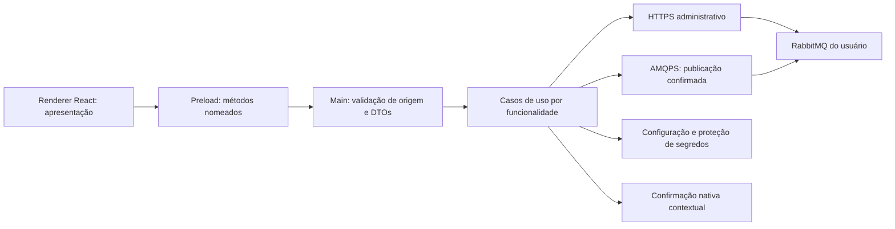

# Arquitetura do Bunnies

Data: 2026-10-28. Status: **Accepted como direção arquitetural e especificação**.
Modernização incremental com Electron, React e TypeScript aprovada pelo proprietário
na conclusão da 1B, junto aos sete ADRs. A aceitação da 1B não implementou o desenho. Os contratos da 2A e da 2B foram
autorizados posteriormente; evidências e limites da implementação estão ao final.

Referências: [avaliação e matriz tecnológica](technology-evaluation.md),
[requisitos funcionais](../02-requirements/functional-requirements.md),
[não funcionais](../02-requirements/non-functional-requirements.md),
[segurança](../08-security/security-model.md) e
[testes](../07-testing/test-strategy.md).

## Decisões aprovadas

| ADR | Proposta |
| --- | --- |
| [ADR-0001](adr/0001-desktop-stack.md) | Electron incremental, Webpack preservado e matriz de ferramentas candidata |
| [ADR-0002](adr/0002-rabbitmq-transports.md) | HTTPS para administração; AMQPS 0-9-1 para publicação |
| [ADR-0003](adr/0003-desktop-security-boundary.md) | Renderer sem privilégio, preload mínimo e validação no núcleo |
| [ADR-0004](adr/0004-local-settings-and-secrets.md) | Configuração JSON versionada e segredos protegidos pelo SO ou apenas em memória |
| [ADR-0005](adr/0005-compatibility-matrix.md) | Matriz inicial de homologação de broker e SO/CPU |
| [ADR-0006](adr/0006-message-inspection.md) | Excluir inspeção/consumo do MVP e exigir semântica explícita depois |
| [ADR-0007](adr/0007-desktop-distribution.md) | Build por alvo, smoke cedo e release sem publicação automática |

## Processos e confiança



O renderer apresenta dados e coleta entradas. O preload encaminha chamadas e eventos
sem expor Electron, Node, URLs de requisição genéricas ou filesystem. O main compõe
casos de uso, transportes, configuração, segredos e confirmações. Respostas do broker
são dados não confiáveis, mesmo que a conexão TLS seja válida.

As operações são locais ao desktop e usam I/O assíncrono. Limitar parsing e respostas
antes de considerar worker/processo auxiliar; adicioná-lo somente por medição. Não
criar serviços remotos ou processos por módulo.

## Organização conceitual aprovada

| Área candidata | Responsabilidade e regra de import |
| --- | --- |
| `src/main` | Composition root, ciclo desktop, IPC e casos de uso; pode importar contratos e adapters |
| `src/preload` | Ponte compilada para sandbox; importa apenas Electron permitido e contratos serializáveis |
| `src/renderer` | Shell, componentes e funcionalidades; não importa main, clientes RabbitMQ ou Node |
| `src/shared` | DTOs, schemas de fronteira e códigos de erro; sem Node, React ou transporte |
| Infraestrutura no main | HTTP, AMQP, persistência e proteção pelo SO; implementa portas pequenas dos casos de uso |
| Regras de negócio | Tipos/regras puros próximos da funcionalidade; extrair domain somente quando trouxer benefício |
| Testes | Próximos das unidades; integração/E2E separados quando criados por contrato |

A estrutura física desktop foi detalhada no contrato aprovado da 2B e está ao final.
A base continua em `src`, `misc` e `tools`; novos módulos exigem contratos próprios
antes de reorganizações adicionais.
O [índice de módulos](../04-modules/module-index.md) conserva os oito limites do produto.

## Contratos IPC candidatos

| Família | Operações específicas | Regra de execução |
| --- | --- | --- |
| Perfis | Listar, salvar, remover, testar endpoints | Nunca retornar senha recuperada; DTO de edição indica apenas se há segredo salvo |
| Sessão | Ativar, selecionar vhost, encerrar, obter estado | ID/generation atribuídos no main; validar contexto em cada operação |
| Filas | Listar, detalhar, criar, excluir, purgar | Nome/vhost explícitos; main resolve endpoint do perfil ativo |
| Exchanges/bindings | Listar/detalhar/criar/excluir e administrar bindings | Preservar identidade da API e argumentos suportados |
| Mensagens | Validar e publicar | Uma publicação em voo, confirmações e resultado incerto |
| Métricas | Obter snapshot, iniciar/parar assinatura | Assinaturas vinculadas à janela/sessão; remoção de listener explícita |
| Desktop | Obter versão/plataforma e abrir links fixos do produto | Sem `openExternal(url)` arbitrário; preferir roles nativas para edição |

Cada request carrega requestId, sessionId/generation quando aplicáveis e DTO
validado. O main verifica a janela e o frame principais, origem exata e tamanho do
corpo; o registro dos handlers é único. Eventos entregam somente dados, não o evento
Electron. A função de assinatura devolve unsubscribe e o encerramento remove recursos.

Resultado conceitual: sucesso com valor ou erro com código, requestId e mensagem
sanitizada. Códigos candidatos: VALIDATION, UNAUTHENTICATED, FORBIDDEN, TLS_ERROR,
NETWORK, TIMEOUT, NOT_FOUND, CONFLICT, UNSUPPORTED, CANCELLED, OUTCOME_UNKNOWN e INTERNAL.
Não devolver stack, URL com credenciais, corpo HTTP bruto ou cabeçalhos de autenticação.
Schemas Zod são candidatos para a fronteira; domínio não depende dessa biblioteca.

### DTOs mínimos para detalhar na implementação

| Contrato | Campos/conteúdo propostos | Regra |
| --- | --- | --- |
| ProfileInput | ID opcional, nome, ambiente, URLs HTTP/AMQP, usuário, CA, modo memória/protegido e ação do segredo manter/substituir/remover | Senha só na substituição; URL sem userinfo; criação/edição validada no main |
| ProfileSummary | ID, nome, ambiente, endpoints sanitizados e indicador de segredo salvo | Nunca incluir senha, ciphertext ou conteúdo de CA |
| SessionContext | sessionId, generation e vhost | O main atribui/valida; não aceitar troca implícita pelo argumento da operação |
| ResourceRef | Contexto, tipo e nome exato do recurso | Preservar caracteres do nome; codificar caminho sem trim ou alteração silenciosa |
| QueueCreate | Nome, tipo classic/quorum, flags do recorte e argumentos catalogados | Chaves desconhecidas rejeitadas; não reconfigurar fila existente automaticamente |
| BindingRef | Contexto, origem/destino, tipo, routing key, argumentos e identidade retornada pela API | Validar identidade recebida e não fabricar chave para exclusão |
| PublishInput | Contexto, exchange, routing key, formato, texto e propriedades/headers permitidos | Headers primitivos tipados; rejeitar número não finito/inteiro sem precisão e dados fora do limite |
| PublishOutcome | confirmed, unroutable, rejected ou unknown, com requestId | Confirm não significa processamento; retorno sem rota não vira sucesso aparente |
| MetricsSnapshot | Contexto, escopo broker/vhost, instante e valores opcionais com estado de disponibilidade | Ausente não é zero; snapshot de memória não implica histórico |

Pedidos IPC rejeitam campos não previstos. Respostas de broker validam campos
necessários e toleram extensões desconhecidas para compatibilidade, sem executar
dados brutos. O contrato de cada etapa definirá schemas e mapeamentos completos;
esta tabela não constitui código implementado ou schema já testado.

## Sessão e recuperação

Uma sessão lógica contém perfil, vhost selecionado, generation e estados separados
dos transportes HTTP/AMQP. Estado agregado: idle, connecting, ready, degraded,
reconnecting ou closed. HTTP disponível e AMQP indisponível permite consultas, mas
não publicação. Não derivar um único status de um socket.

Ao trocar perfil/vhost: cancelar leituras/assinaturas, invalidar generation, fechar
recursos antigos e descartar respostas atrasadas. Confirmar operações críticas antes
da troca ou explicar resultado incerto de escrita já enviada. Não reconectar perfil
antigo após encerramento explícito. Backoff/timeouts seguem NFR-013/019.

Uma leitura pode ser repetida pela política limitada; erros de credencial, permissão
ou certificado não geram tempestade de reconexão. Nenhuma escrita é repetida
automaticamente. Polling é centralizado, limitado e cancelável, sem múltiplos timers
por componente ou requisições sobrepostas da mesma consulta.

## Adapter administrativo

Proposta: HTTPS do Node no main, com CA por conexão, limitação de bytes descomprimidos,
timeout e cancelamento; sem biblioteca HTTP adicional inicialmente. Não seguir
redirecionamentos automaticamente nem herdar proxy corporativo silenciosamente.
Proxy configurável está fora do MVP; isso precisa estar explícito na conexão.

| Caso de uso | Endpoint candidato da Management API |
| --- | --- |
| Versão/resumo | `GET /api/overview` |
| Vhosts | `GET /api/vhosts` |
| Filas | `GET /api/queues/{vhost}` e `GET /api/queues/{vhost}/{name}` |
| Consumidores da fila | Dados do detalhe ou consulta de consumidores filtrada conforme versão |
| Criar/excluir fila | `PUT` / `DELETE /api/queues/{vhost}/{name}` |
| Purge | `DELETE /api/queues/{vhost}/{name}/contents` |
| Exchanges | `GET /api/exchanges/{vhost}` e operações específicas por nome |
| Bindings | Endpoints de bindings queue/exchange conforme direção e identidade retornada |

Validar esses contratos nas duas versões-alvo antes de homologar. Codificar cada
segmento, inclusive `/` do vhost; não construir URL por concatenação de entradas.
Usar paginação/campos reduzidos onde suportados. Vhosts e outros endpoints sem
paginação documentada mantêm limite de resposta e erro explícito, sem paginação fictícia.
Tags de management não comprovam permissões AMQP ou todas as permissões de recurso.
Erros 401/403 são interpretados por operação, sem elevar privilégios.
[Referência administrativa](https://www.rabbitmq.com/docs/http-api-reference).

Catálogo inicial de criação de filas: `x-queue-type` classic/quorum; opções
`x-message-ttl`, `x-max-length`, `x-dead-letter-exchange` e `x-dead-letter-routing-key`
apenas quando validadas pela matriz. Inteiros finitos e dentro da faixa do contrato;
nomes válidos e nenhuma chave extra arbitrária. Quorum usa durabilidade e restrições
compatíveis; o broker pode rejeitar argumentos/policies e seu erro deve ser explicado.
Não modificar silenciosamente fila existente para resolver conflito de declaração.
[Propriedades de filas](https://www.rabbitmq.com/docs/queues).

## Adapter de publicação

Candidato: amqplib no main. Abrir conexão apenas após ativação/teste explícito e
canal confirm para publicação; configurar heartbeat e limites segundo broker e
contrato de integração. Não assumir reconexão automática da biblioteca.

Uma publicação de cada vez simplifica a associação de retorno/confirm ao envio.
Usar `mandatory`, tratar retorno sem rota, nack, fechamento e deadline. O booleano
de `publish` indica backpressure, não confirmação do broker; aguardar drain quando
necessário e o callback/confirm correspondente. Confirm não significa processamento
pelo consumidor. Se o resultado ficar ambíguo, apresentar OUTCOME_UNKNOWN e não reenviar.
[API do cliente](https://amqp-node.github.io/amqplib/channel_api.html) e
[confirmações](https://www.rabbitmq.com/docs/confirms).

## Confirmações destrutivas e concorrência

O caso de uso valida alvo e sessão, solicita confirmação nativa ao usuário por uma
porta injetável e revalida generation/alvo depois do diálogo. Não aceitar apenas
`confirmed: true` fornecido pelo renderer. O diálogo identifica ambiente, endpoint
sem segredo, vhost, nome, operação e efeito. Cancelar não envia a escrita.

Usar condições do broker para exclusão quando disponíveis; confirmação não elimina
corridas com consumidores/produtores externos. Purge não é snapshot, rollback ou
remoção garantida de mensagens já entregues. Testes automatizados da política usam
fake de confirmação; diálogos reais recebem teste manual por SO.

## Configuração e segredos

Arquivo JSON local em diretório de dados do usuário, schemaVersion e limite de
tamanho; perfis guardam ID, metadados, endpoints sem userinfo, usuário, referência
de CA e ciphertext opcional. Senha só em memória ou criptografada, nunca em settings
do renderer/localStorage. Escrever de forma atômica e preservar arquivo inválido.

Proteção candidata: API assíncrona safeStorage da versão escolhida. Linux exige
evidência de provider seguro; a existência de API/retorno booleano isoladamente não
prova isso. Se fallback fraco ou provider incerto, manter somente memória até
verificação. Não prometer proteção contra outro processo comprometido do mesmo usuário.
[Detalhes de segurança](../08-security/security-model.md).

## Critérios de arquitetura e evolução

- Renderer e shared não importam main/Node/adapters; preload permanece mínimo.
- Composition root liga casos de uso a adapters; funções puras recebem dados, não Electron.
- Identidade e tokens existentes preservados; navegação e telas detalhadas na Etapa 3A.
- Logs limitados e sanitizados; limites e tempos têm uma fonte em NFR-013–021.
- Estratégia de testes separa fakes, brokers isolados e smoke real do pacote.
- Os sete ADRs estão aceitos; os contratos de implementação continuam exigindo
  aprovação antes de criar diretórios, migrar ferramentas ou integrar ambientes reais.

A resolução e a fronteira foram verificadas no recorte local das etapas 2A/2B.
Ainda não comprovados: providers de credenciais, CA, demais SOs/CPUs, confirmação
destrutiva real e formatos/assinatura de distribuição. Automação Electron continua
experimental. A
[estratégia de testes](../07-testing/test-strategy.md) define os gates futuros.

## Estado da fundação após a execução autorizada da 2A

A estrutura existente foi preservada. Foram adicionados testes próximos das unidades,
configurações na raiz, workflow e smoke em `tools/testing`, conforme contrato.
Instalação, tipagem/lint, testes e pacote/smoke local foram executados; os demais
gates desta arquitetura permanecem pendentes. A conclusão da 2A e seu commit foram aprovados com “Sim”.
Ver [evidências e limitações](../07-testing/foundation-2a.md).

## Organização desktop implementada na Etapa 2B

O contrato físico da 2B foi autorizado após `27e4f95`. Estrutura atual:

```text
src/
  main/
    app.ts                 # composição, sessão, protocolo e ciclo da aplicação
    appWindow.ts           # janela única e política de navegação
    ipc/desktop.ts         # registro único, autenticação e execução limitada
    security/
      desktopPolicy.ts     # URL, DTO e allowlist de recursos
      resources.ts         # recursos locais/MIME/CSP e confinamento por realpath
      session.ts           # permissões, rede Chromium e downloads
  preload/
    index.ts               # entrypoint sandboxed e contextBridge
    desktopApi.ts          # métodos nomeados e contenção de falhas de transporte
  shared/desktop.ts        # DTOs/resultados, sem Node/Electron/React
  renderer/                # interface legada e feedback de erro
misc/window/               # componentes preservados; sem ponte ou handlers legados
tools/testing/              # automação privilegiada, fora da API da aplicação
```

Testes ficam junto das unidades. Tipos compartilhados não importam camadas
privilegiadas; lint restringe imports de Node/Electron/main no renderer e de
Node/main no preload. Isso auxilia manutenção, sem constituir isolamento de runtime.

A ponte `window.bunnies` expõe getInfo, close, quit, minimize, toggleMaximize,
showEditMenu, view com enum limitado e openLink com identificador fixo. Todos
encaminham ao handler estático bunnies:desktop, que valida a janela/frame/página e
o DTO antes de executar. Não há invoke/send genéricos, eventos Electron ou URL
arbitrária. Edição/clipboard usam roles de menu nativo; a UI só solicita abrir esse
menu. Versão/plataforma vêm do main, substituindo metadados mutáveis no DOM.

Resultados de erro têm código, requestId e mensagem fixa, sem stack/path/argumentos.
O fechamento remove a referência à janela, não encerra forçadamente o app macOS;
activate reutiliza/cria a principal e os handlers permanecem registrados uma vez,
com remoção ao sair. Funcionalidades RabbitMQ não foram antecipadas.

Produção usa bunnies://app/app_window/index.html e recursos explícitos, sem servir
preload/maps/package.json. CSP em headers, CSS extraído e sessão sem rede no renderer.
Desenvolvimento usa somente localhost com estilos/HMR permitidos nesse perfil; o
preload tem configuração própria, sem cliente HMR ou shims Node. A mudança de origem
file para bunnies não migra a preferência de tema antiga; o usuário pode escolhê-la
novamente. Ainda não existiam perfis ou credenciais a migrar.

A conclusão da 2B e seu commit foram aprovados por “Aprovado”; [resultados reais](../07-testing/desktop-boundary-2b.md).
Não confundir estes controles locais com homologação dos quatro alvos, integração
segura de broker ou proteção de artefato de release com fuses/assinatura.
