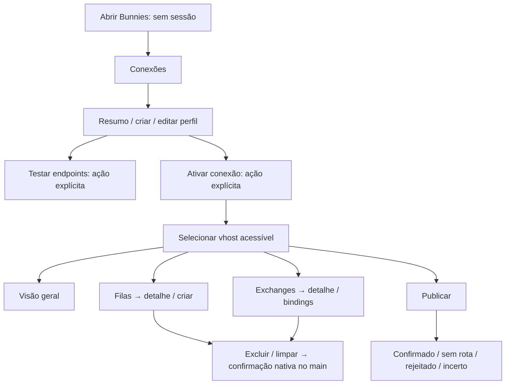

# Navegação desktop — design aprovado na Etapa 3A

Data: 2026-10-28. Status: **Accepted**; execução autorizada por “Autorizo” e
design D3A-01–08/conclusão/commit aprovados depois por “Aprovado”. Base: `39234fa`;
fundação 2B em `a550731`. O aceite não implementa fluxos nem autoriza executar a 3B.
Referências: [MVP](../02-requirements/mvp-scope.md),
[requisitos](../02-requirements/functional-requirements.md),
[design system](design-system.md) e [mockups](ui-proposals/README.md).

## Direção recomendada

Cinco destinos principais: **Conexões, Visão geral, Filas, Exchanges e Publicar**.
Contexto de conexão/ambiente/vhost fica separado da navegação de recursos e sempre
visível. Monitoring fornece dados à visão geral; não cria outra tela com as mesmas
métricas. Administração do MVP é seleção de vhost e respeito a permissões, não uma
seção antecipada de usuários/policies. Produtividade é transversal, sem uma tela vazia.

| Alternativa | Benefício | Limite | Recomendação |
| --- | --- | --- | --- |
| Sidebar curta + contexto fixo + páginas de recurso | Destinos estáveis, contexto explícito, espaço para tabelas | Exige comportamento compacto no redimensionamento | Recomendada |
| Árvore de conexões/vhosts/recursos | Expõe hierarquia na mesma área | Repete recursos entre perfis, consome largura e sugere sessões simultâneas fora do MVP | Adiar; não implementar agora |

Rótulos dos mockups em **PT-BR**, como proposta para revisão. Preservar termos
RabbitMQ (exchange, binding, routing key, vhost, unacked) e nomes exatos de recursos.
Não adicionar internacionalização ou uma biblioteca de roteamento nesta etapa.

## Shell e contexto

| Região | Conteúdo e comportamento |
| --- | --- |
| Barra da janela | Nome Bunnies e controles do SO; edição/atalhos nativos preservados; áreas de arraste não englobam campos e botões |
| Sidebar | Marca, cinco destinos, preferência de tema e Sobre; destino ativo por forma/texto e cor |
| Contexto fixo | Ambiente com texto/símbolo, nome do perfil, seletor de vhost e estados HTTPS/AMQPS independentes |
| Conteúdo | Título, escopo, ações, filtros, dados/estado vazio ou erro; apenas essa área troca na navegação |
| Atualidade | Instante da leitura, origem/escopo dos dados e estado de atualização; não chamar snapshot antigo de atual |

Começar em Conexões **sem sessão ativa**. Selecionar um perfil só abre seu resumo.
Testar endpoints e Ativar conexão são solicitações explícitas distintas; não testar
em background ao selecionar, iniciar o app ou abrir a lista (FR-003/029).
Testar não cria topologia ou publica mensagens. Trocar de destino da sidebar não
troca conexão/vhost silenciosamente.

Os quatro destinos dependentes de broker ficam indisponíveis sem sessão/contexto
adequado, com razão acessível, como “Ative uma conexão para acessar as filas”.
Não apresentar dados de exemplo como broker conectado no aplicativo. Dados dos SVGs
são fixtures documentais; a 3B não deve instalá-los como uma sessão falsa de produção.

Produção aparece como **PRODUÇÃO + símbolo**, além da cor. Mostrar o nome completo
de conexão e vhost por quebra de linha/expansão focável quando não couberem; contexto
crítico e ações não podem desaparecer em ellipsis sem alternativa. Endpoints em
resumos/diálogos não contêm senha, token ou userinfo.

Navegação será estado local do renderer, sem alterar a URL fixa validada pela 2B.
Histórico de telas pode ficar em memória; não planejar rotas HTTP, servidor próprio,
deep links externos ou infraestrutura de produto web.

## Mapa proposto

## Estados de conectividade e capacidade

| Situação | Feedback e ações |
| --- | --- |
| Sem sessão | Conexões e preferências disponíveis; nenhum contador zero fictício; nenhum pedido ao broker |
| Conectando | Indicador por endpoint, contexto do perfil e possibilidade de encerrar; UI continua respondendo |
| HTTPS e AMQPS disponíveis | Habilitar somente operações autorizadas e suportadas; “conectado” não significa administrador |
| HTTPS disponível, AMQPS indisponível | Consultas administrativas disponíveis; publicar bloqueado com motivo; retry de AMQPS conforme política |
| HTTPS indisponível, AMQPS disponível | Publicar somente com sessão/vhost já validados no AMQP e destino explícito; consultas/listas indisponíveis, sem topologia inventada; contexto não validado mantém o bloqueio |
| Reconectando | Tentativa/estado visíveis, dados antigos marcados; sem replay de escritas |
| Autenticação, TLS ou permissão negada | Mensagem específica sanitizada; editar perfil/CA ou rever permissão; nenhuma opção de ignorar certificado/elevar privilégios |
| Capacidade desconhecida ou não suportada | Explicar bloqueio por ação; não executar para “ver se funciona”; não mostrar sucesso aparente |

Estados de endpoint, autorização da operação e atualidade dos dados são dimensões
distintas. Nunca condensá-las num único ponto verde. Capacidade suportada e permissão não são
sinônimos: tags não comprovam todas as autorizações. Quando a permissão exata não
puder ser consultada, uma ação suportada pode depender da resposta do broker,
com contexto/confirmação e erro explícitos; não promover privilégios.
O renderer não decide confiança
TLS, persistência segura ou permissões reais: apresenta resultados do núcleo.

## Fluxos por destino

### Conexões

Lista local com nome, ambiente e resumo dos endpoints; indicar “não testado nesta
sessão” em vez de reaproveitar um teste antigo como status atual. Resumo pode ter
campos somente leitura selecionáveis pelo teclado e menu nativo.

Criar/editar apresenta nome, ambiente, HTTPS, AMQPS, usuário, CA e modo de segredo.
Senha nova fica em campo password, não em URL. Segredo recuperado nunca preenche o
formulário: mostrar “há senha guardada”, com substituir/remover. Modo em memória
disponível; persistência só habilitada após proteção do SO comprovada pelo núcleo.
Se indisponível, explicar ao usuário e manter o modo em memória, sem termos internos
como basic_text na tela principal. Não prometer proteção absoluta.

Sem senha disponível, Testar/Ativar solicita o segredo no contexto do perfil antes
de enviar a requisição. Testes retornam dois resultados, sem ativar uma sessão
implicitamente. Remover perfil exige esclarecer que não remove recursos do broker.
Não disponibilizar mTLS/OAuth/proxy como controles aparentemente operacionais no MVP.

### Visão geral

Primeiro declarar **escopo vhost** e instante/origem da leitura. Exibir contadores
disponíveis e filas prioritárias; ausência/permissão negada é “Indisponível”, não 0.
Se futuramente houver dados globais do broker, separá-los visualmente e por rótulo.
Não somar apenas a página carregada e apresentar o resultado como total do vhost.

Atualizar manualmente e mostrar pausa em background/dado antigo. Intervalo segue
NFR-018; nenhuma sobreposição ou timer por card. Gráficos aprofundados, histórico e
alertas ficam pós-MVP; os mockups não insinuam histórico persistente.

### Filas

Tabela por vhost com nome exato, tipo, prontas, unacked, total e consumidores.
Filas abrem detalhe com propriedades, argumentos, consumidores e bindings.
Ajuda acessível explica: prontas aguardam entrega; unacked foram entregues e ainda
não confirmadas. Valores pertencem ao snapshot, não a uma garantia de estado atual. Sem
checkboxes de seleção em lote nem aba de leitura/consumo de mensagens no MVP.

Busca/filtros declaram seu universo: consulta do vhost quando a API suportar; se
aplicados apenas aos itens já carregados, rotular “Nesta página” e não simular busca
global. Paginação deve refletir o broker, com total conhecido ou explicitamente
desconhecido. O mockup mostra nove linhas visíveis de uma página de 100 itens, com
rolagem; isso não demonstra performance nem exige virtualização antecipada.

Criar aceita apenas o catálogo aprovado de classic/quorum e argumentos suportados.
Recorte inicial durável, não exclusivo, sem auto-delete; explicar valores fixos,
em vez de controles editáveis que o núcleo ignoraria. Não reconfigurar uma fila
incompatível silenciosamente.

Excluir e Limpar mensagens prontas ficam em menu secundário da fila, separados da
abertura de detalhes. Mostrar contexto completo antes da execução; no detalhe,
ações destrutivas continuam separadas das ações frequentes. Não prometer contagem
imutável, rollback ou remoção de mensagens já entregues.

### Exchanges e bindings

Lista e detalhe com tipo, flags suportadas e bindings. Identificar a exchange padrão
como “Padrão (nome vazio)”, preservando o identificador canônico vazio. Recursos
reservados não recebem operações indevidas. Editor de binding informa origem,
destino/fila ou exchange, routing key e argumentos catalogados. Exclusão usa a
identidade devolvida pela API e confirmação contextual, nunca uma chave inventada.

### Publicar

Contexto de ambiente/vhost e destino ficam visíveis acima do payload. Texto/JSON,
tamanho UTF-8, content type, persistência, messageId/correlationId e headers tipados.
Validar antes do envio e manter erros junto ao campo. Não executar preview HTML,
scripts ou templates de código; exemplos de payload pertencem ao harness/documentação.

| Resultado | Mensagem proposta | Próxima ação |
| --- | --- | --- |
| Confirmado sem retorno de falta de rota | “O broker confirmou a publicação.”; não afirmar processamento pelo consumidor | Nova edição/envio explícito |
| Sem rota | “O broker devolveu a mensagem sem rota.” | Rever exchange/routing key/bindings |
| Rejeitado | “O broker rejeitou a publicação.” | Diagnóstico e correção; não repetir automaticamente |
| Incerto | “Não foi possível confirmar o resultado. A mensagem pode ter sido enviada.” | Sem retry automático; nova tentativa explícita com aviso de duplicação |

Só uma publicação em voo. Cancelar/fechar a tela depois de enviar não significa
desfazer a publicação. [Semântica de confirms](https://www.rabbitmq.com/docs/confirms).

## Troca de contexto, erros e ações destrutivas

- Leituras antigas são canceladas/invalidadas ao trocar perfil/vhost; respostas
  atrasadas não atualizam o contexto novo. Não manter duas sessões ativas como atalho.
- Se houver edição local não salva, oferecer continuar editando ou descartar e
  trocar; descarte explícito, sem salvar payload em histórico/localStorage.
- Escrita enviada sem resultado requer avisar a incerteza ao trocar/encerrar; não
  atribuir uma confirmação atrasada ao novo perfil nem repetir a operação.
- Erro de página tem ação contextual, detalhes sanitizados e ID de diagnóstico;
  feedback de operação incerta/destrutiva permanece até ser reconhecido, sem sumir
  em toast rápido. Sucesso transitório pode usar aviso não intrusivo.
- Confirmações de excluir/purge/remover binding são **nativas e executadas pelo main**,
  com ambiente, endpoint sanitizado, vhost, recurso e efeito. Cancelar é o padrão;
  Escape/fechar não executam. Revalidar a sessão após o diálogo. Não usar booleano do
  renderer como autorização. O mockup nativo ilustra conteúdo, não implementação.

A API de purge e os efeitos devem ser confirmados nas versões-alvo da integração;
o snapshot pode mudar antes da ação. [HTTP API](https://www.rabbitmq.com/docs/http-api-reference).

## Rastreabilidade do MVP

| Requisitos | Destino/padrão proposto |
| --- | --- |
| FR-001/002/003/028/029 | Conexões, modo de segredo, CA e Testar/Ativar explícitos |
| FR-004/005/019/020/025/027 | Contexto fixo, vhost/capacidades, estados e troca de sessão |
| FR-006/021/022 | Visão geral, escopo, snapshot e atualização limitada |
| FR-007/008/009/010/011 | Filas, detalhe, criar e menu destrutivo contextual |
| FR-012/013/014 | Exchanges, padrão/reservados, bindings e confirmações |
| FR-015/016/017/018 | Editor/publicação, propriedades e resultado incerto |
| FR-023/024/026/030 | Shell, teclado/tema, estados/erros e fronteira desktop |

FR-031–038 não ganham telas/ações funcionais por este planejamento. Não criar busca
global, favoritos, histórico, inspeção, CRUD administrativo ou comparador de ambientes
por antecipação. As operações só serão habilitadas nas etapas dos módulos aprovados.

## Recorte recomendado para a 3B

Implementar somente shell/navegação local, temas/preferências não sensíveis,
primitivas visuais/acessíveis e estados offline/sem sessão. A rota inicial é Conexões;
componentes de tabela/formulário podem ser exercitados com fixtures em testes,
sem simular um broker conectado na execução normal. Não tornar CTAs operacionais
antes dos casos de uso correspondentes. Design não autoriza novos comandos IPC.

Conexões reais/cofre continuam em 4A; Management em 4B; filas, exchanges, mensagens
e monitoramento nas suas etapas. Submeter o contrato físico/testes da 3B após
aprovação da direção visual e conclusão/commit da 3A. Esse aceite já foi recebido;
o contrato da 3B está no [roadmap](../05-roadmap/roadmap.md) e recebeu autorização
própria por “Sim”.

## Estado implementado na 3B

Shell/contexto sem sessão, Conexões vazia, Sobre e temas foram implementados e
aprovados na conclusão da 3B por “Aprovado”. Quatro destinos de broker continuam bloqueados com razão acessível;
não há perfis de demonstração na execução normal. Navegação e controle para pular
conteúdo preservam a URL. Cmd/Ctrl+5 acessa Conexões fora de edição; os outros
atalhos de destinos ainda indisponíveis não foram registrados.

O painel compacto usa dialog HTML com contenção de foco e Escape/retorno ao gatilho.
Isso não implementa confirmações destrutivas do main. Os fluxos de broker acima
continuam requisitos aprovados para as próximas etapas. Ver
[evidências e limites](../07-testing/interface-3b.md); conclusão/commit da 3B aprovados.

## Incremento autorizado DOC.1 — Ajuda

O pedido do proprietário após o aceite 4A.1 autorizou Ajuda na barra lateral,
junto de Sobre/tema, preservando os cinco destinos principais. Ajuda é destino
local adicional, com índice e tópicos offline; sem sessão, rede ou alteração da
URL canônica. Abrir foca h1; selecionar tópico foca seu h2; Voltar ao índice foca
o primeiro tópico. Painel compacto oferece a mesma entrada e fecha ao navegar.

Campos/formulários são documentados a partir do uso real; recursos ainda ausentes
ficam claramente identificados. O formulário modal de perfil continua bloqueando
navegação externa e atalho durante edição. Fonte e fluxo: [guia do usuário](../10-user-guide/README.md).
