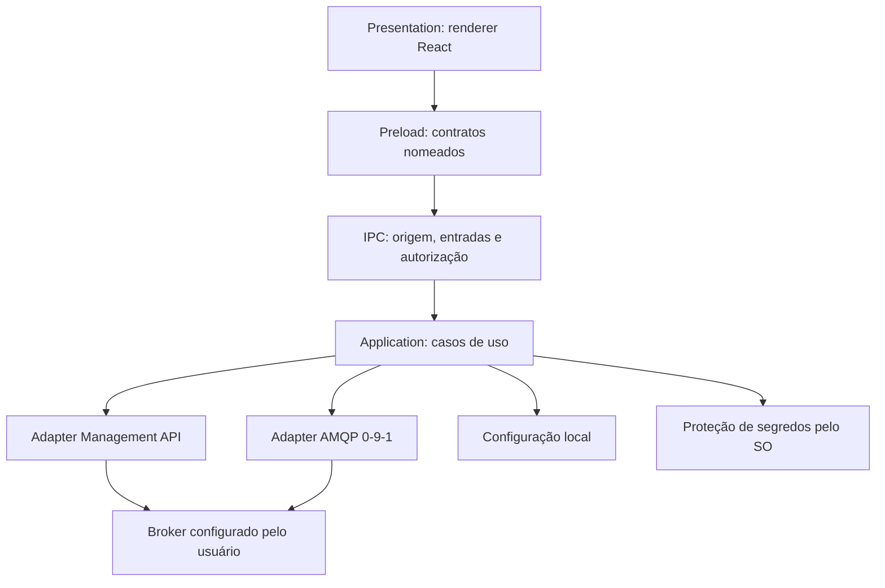

# Avaliação tecnológica

Data: 2026-10-28. Status: **direção tecnológica e matriz candidata aprovadas**.
Registrada na Etapa 1A e detalhada na 1B; o aceite de conclusão da 1B aprovou os sete
ADRs e a seleção para validação. A matriz não foi instalada ou homologada. Atualização
de pacotes e implementação dependem da autorização da etapa correspondente.

## Contexto comprovado

A [análise do legado](../01-audit/legacy-analysis.md) encontrou uma base pequena
Electron/React com temas e janela customizada, sem integração RabbitMQ. Há componentes
reutilizáveis, mas poucas regras de negócio a migrar. A
[auditoria de dependências](../01-audit/dependency-audit.md) registra incompatibilidades
entre algumas publicações atuais de compilador, lint e plugins.

## Comparação das stacks

| Critério | Prioridade | Electron + React + TypeScript | Tauri + React + TypeScript + Rust |
| --- | --- | --- | --- |
| Segurança | Crítica | Sandbox, preload mínimo, IPC validado e runtime Chromium atualizado | Capabilities, comandos/escopos restritos e validação Rust; WebView atualizada |
| Manutenibilidade | Crítica | Continuidade e linguagem predominante única | Duas linguagens e cadeias de ferramentas |
| RabbitMQ | Crítica | Cliente Node no main e transporte HTTP local | Clientes HTTP e AMQP Rust no núcleo, a homologar |
| Multiplataforma | Crítica | Chromium incluído reduz diferenças de renderização | WebView2, WKWebView e WebKitGTK exigem homologação visual por SO |
| Reaproveitamento | Alta | Maior reaproveitamento de main, preload e tooling | React/CSS aproveitáveis; núcleo e ponte desktop reimplementados |
| Desempenho | Alta | Precisa de benchmark representativo | Precisa do mesmo benchmark; Rust não garante velocidade da UI |
| Memória | Alta | Custo do Chromium distribuído | Potencial de redução dependente da WebView, SO e carga |
| Experiência desktop | Alta | APIs maduras; corrigir convenções por plataforma | Integração desktop disponível; validar detalhes por plataforma |
| Complexidade | Alta | Menor mudança inicial para este repositório | Rust, runtime assíncrono, plugins e capabilities adicionais |
| Qualidade visual | Alta | React/CSS em motor relativamente uniforme | React/CSS com diferenças entre motores |
| Distribuição | Alta | Runtime controlado pelo aplicativo; instaladores maiores | Binário potencialmente menor; runtime e dependências do sistema |
| Maturidade | Alta | Ecossistema estabelecido | Alternativa estabelecida com requisitos próprios de operação |

Electron distribui Chromium e Node; Tauri usa WebView do sistema. Os componentes
React continuam HTML/CSS, não widgets inteiramente nativos. Instalar um aplicativo
desktop não cria uma versão web do produto. [Processos Tauri](https://v2.tauri.app/concept/process-model/).

No Tauri, capabilities delimitam acesso do frontend a recursos expostos; os comandos
do núcleo ainda precisam de validação e política explícita. Rust não protege contra
comandos permissivos, tratamento incorreto de segredos ou falhas de lógica.
[Segurança Tauri](https://v2.tauri.app/security/) e
[capabilities](https://tauri.app/security/capabilities/).

No Electron, a aplicação precisa manter seu runtime e validar todas as fronteiras
privilegiadas. A base atual já desativa Node no renderer e isola contexto, mas ainda
precisa de sandbox e hardening. [Segurança Electron](https://www.electronjs.org/docs/latest/tutorial/security).

Não existem medições de RAM, startup ou tamanho final. Não prometer percentuais de
economia. Avalonia, Qt e JavaFX não apresentaram benefício concreto que justifique
ampliar esta avaliação inicial e reescrever a interface em outro ecossistema.

## Cenários de modernização

| Cenário | Benefícios | Riscos e complexidade | Esforço relativo | Consequência |
| --- | --- | --- | --- | --- |
| A — Conservador | Preserva organização e reduz mudança inicial | Segurança exige refatoração mesmo assim; produto novo pode crescer em base inadequada | Menor inicial | Possível retrabalho estrutural |
| B — Incremental | Preserva identidade/componentes e introduz limites por funcionalidade | Exige disciplina e conclusão de cada recorte | Médio | Entregas menores, verificáveis e evolução controlada |
| C — Reestruturação completa | Liberdade para reconstruir fundação e considerar Tauri | Troca simultânea de tooling/IPC/runtime aumenta incerteza | Maior inicial | Adequado se requisitos invalidarem a base atual |

**Decisão aprovada:** cenário B com Electron, conforme ADR-0001 aceito.
Isso reduz decisões simultâneas enquanto a integração e os fluxos do produto serão
construídos. Stack e matriz candidata foram aceitas para validação, sem comprovar
resolução transitiva ou compatibilidade de runtime.

Se RAM ou tamanho forem determinantes, propor prova de conceito separada: mesma tela,
consulta administrativa, publicação TLS e carga de dados em ambos; medir builds de
release, startup, recursos e distribuição nos sistemas-alvo. Esse protótipo depende
de contrato e autorização antes da escrita ou instalação.

## Arquitetura local proposta

O desenho usa Electron conforme ADR-0001 aceito. Uma mudança futura para Tauri
exige decisão revisada antes de adaptar a fronteira para commands/capabilities e Rust.

| Responsabilidade | Limite proposto |
| --- | --- |
| Presentation | Componentes, acessibilidade, formulários e estado visual |
| Application | Casos de uso por funcionalidade, sessão ativa e política de execução |
| Domain | Regras concretas, identidades e validações independentes da UI |
| Infrastructure | HTTP, AMQP, configuração, segredos e logging |
| Desktop | Janelas, ciclo de vida e fronteira privilegiada |

Essas divisões são conceituais. Não criar uma camada, framework ou processo para
cada responsabilidade sem benefício demonstrado. A organização de diretórios será
definida no contrato de implementação com a stack já aprovada, sem infraestrutura
de suporte a versão web.

## Contratos e estado

Os contratos devem separar perfis/sessão, administração, publicação e persistência.
Expor operações específicas com entradas/saídas serializáveis e erros tipados; não
expor cliente HTTP genérico, canais IPC arbitrários ou acesso direto ao filesystem.
Configuração, rede e recuperação de segredos pertencem ao núcleo privilegiado.

Hooks e Context podem continuar para estado visual. Estado remoto deve ser separado
por perfil/vhost, com cancelamento e descarte de respostas da sessão anterior.
Uma biblioteca de cache ou estado só será escolhida quando os fluxos demonstrarem
necessidade. Evitar store global que combine toda a aplicação.

I/O deve ser assíncrono, com limites de payload, tempo e concorrência. Processamento
pesado pode exigir worker/processo auxiliar se medições demonstrarem necessidade;
isso não está decidido. O índice de responsabilidades e dependências está em
[módulos](../04-modules/module-index.md).

## RabbitMQ: administração e mensageria

| Operação | Mecanismo proposto | Condição |
| --- | --- | --- |
| Recursos administrativos e métricas | Management API via HTTPS | Plugin e permissões apropriados |
| Publicação | AMQP 0-9-1 com TLS | Endpoint, autenticação e permissões de publicação |
| Consumo, ack e requeue | Fora do MVP | Requer definição explícita de efeitos |
| Inspeção | Pós-MVP diagnóstico | Não representar como leitura passiva |

HTTP e AMQP terão endpoints configuráveis separadamente e poderão ter estados de
conectividade diferentes. Para HTTP: codificar nomes/vhosts, paginar, limitar
respostas e distinguir falta de permissão de recurso ausente. A publicação HTTP é
ineficiente segundo a documentação; priorizar protocolo de mensageria.
[HTTP API](https://www.rabbitmq.com/docs/http-api-reference).

`amqplib` é um candidato Node; `Lapin`, um candidato Rust. Seleção, versão, TLS,
reconexão e compatibilidade ainda dependem de teste.
[amqplib](https://amqp-node.github.io/amqplib/) e [Lapin](https://github.com/amqp-rs/lapin).

Publicação deve distinguir confirmação do broker, retorno por ausência de rota e
resultado incerto após perda de rede. Retry automático de operação já enviada pode
duplicar efeitos. [Publicadores](https://www.rabbitmq.com/docs/publishers).

Obter mensagens por HTTP altera a fila; requeue não é observação passiva. A operação
é documentada para diagnóstico/desenvolvimento. Consumo AMQP também pode afetar
redelivery, ordem e políticas da fila. A inspeção não integra o MVP proposto.
[Operação de obtenção](https://www.rabbitmq.com/docs/http-api-reference#post-apiqueuesvhostnameget).

## Compatibilidade proposta

| Série RabbitMQ | Posição proposta |
| --- | --- |
| 4.4.x | Alvo principal de homologação |
| 4.3.x | Alvo adicional de homologação |
| 4.2.x, 4.1.x e 3.13.x | Avaliar somente conforme necessidade real; sem garantia inicial |
| Outras séries/plugins | Não presumir compatibilidade |

Na consulta de 2026-10-28, 4.3 e 4.4 tinham suporte comunitário; séries anteriores
possuíam situações distintas de suporte comercial. Isso justifica alvos, não uma
declaração de compatibilidade já testada. [Releases RabbitMQ](https://www.rabbitmq.com/release-information).

Detectar versão, capacidades e permissões. Não transformar campo indisponível em
zero nem usar endpoints descontinuados como prova de saúde. Validar diferenças por
versão, plugins e tipos de fila em instâncias isoladas. O plugin de management
precisa estar disponível para as funções administrativas.
[Management](https://www.rabbitmq.com/docs/management).

## Segurança proposta

- Sandbox e isolamento, política de navegação, CSP de produção e comandos mínimos.
- Verificação do remetente IPC e validação de todos os argumentos no núcleo.
- Proteção de segredos com mecanismos do SO; UI não recebe segredos recuperados.
- TLS validado com CA configurável; não ignorar erros de certificado.
- Redação de logs, limites de payload e renderização de mensagens como dados.
- Identificação de ambiente e confirmação contextual de exclusão, purge e operações
  que removem ou consomem dados; respeitar permissões do broker.
- Timeouts, cancelamento e reconexão com espera progressiva; sem repetir ações de
  escrita por falha ambígua. Bloquear redirecionamento que exponha autenticação.

`safeStorage` é candidato no Electron, com semântica diferente por SO. Se o Linux
retornar backend `basic_text` ou proteção indisponível, a proposta é impedir salvar
credenciais e permitir apenas uso em memória. A API efetiva depende da versão
aprovada. [safeStorage](https://www.electronjs.org/docs/latest/api/safe-storage).

Não há implementação de armazenamento ou auditoria dinâmica. O modelo de segurança
e os ADRs foram aprovados na 1B; seus controles exigem implementação e testes antes
de integrar credenciais reais.

## Navegação e design propostos

Conexões → Visão geral → Filas → Exchanges → Publicar mensagem. Manter conexão,
ambiente e vhost visíveis; mostrar carregamento, erro, vazio e dados desatualizados.
Preservar o símbolo e as cores existentes. Evoluir tokens semânticos para superfícies,
texto, ações, risco, foco, tipografia, espaçamento e densidade. Aprovar os valores e
componentes antes de implementar telas complexas.

Priorizar campos, botões, tabelas, alertas, diálogos e indicador de conexão. Produção
precisa de texto/símbolo além de cor. Operações destrutivas devem identificar alvo e
efeito; atalhos precisam respeitar o SO e não disparar destruição inadvertidamente.

## Testes e distribuição a decidir

Propor testes de casos de uso, contratos IPC e componentes; integração com brokers
isolados; autenticação/TLS; falhas de rede e reconexão; confirmações AMQP; permissões
e operações destrutivas. E2E devem cobrir os fluxos principais com recursos efêmeros.
Fixtures, matriz e critérios foram planejados na 1B; nenhum desses testes foi executado.

Planejar smoke de empacotamento cedo e testes de instalação por SO/CPU. Conforme
ADR-0007, os candidatos aceitos são Squirrel Windows, DEB Ubuntu e ZIP macOS;
RPM/DMG exigem recortes posteriores. Assinatura, notarização, updater e publicação exigem infraestrutura,
certificados e autorização próprios. Uma máquina não homologa todos os artefatos.

## Decisões arquiteturais aprovadas

Na Etapa 1B, os sete registros abaixo foram criados como Proposed e posteriormente
aceitos pela resposta explícita “Aprovado” do proprietário. Contêm identificador,
título, data, status Accepted, contexto, alternativas, decisão, justificativa e
consequências. O índice com links está na
[arquitetura](architecture.md).

| Registro aceito | Questão |
| --- | --- |
| ADR-0001 | Stack desktop |
| ADR-0002 | Separação Management API / AMQP |
| ADR-0003 | Fronteira de segurança e contratos IPC |
| ADR-0004 | Proteção e persistência de credenciais |
| ADR-0005 | Matriz de compatibilidade RabbitMQ |
| ADR-0006 | Semântica e restrições de inspeção |
| ADR-0007 | Empacotamento e distribuição |

Status possíveis: Proposed, Accepted, Superseded, Rejected. Aprovar a escrita de um
ADR não aprova sua decisão. Seguir o [roadmap e os contratos](../05-roadmap/roadmap.md).

## Matriz tecnológica candidata — detalhamento da Etapa 1B

Reconsulta em 2026-10-28. Não houve instalação, geração de lockfile ou build. Versões
abaixo são candidatas aprovadas para validação, não uma combinação homologada. O snapshot da
auditoria permanece inalterado em `docs/01-audit/`.

| Componente | Versão candidata | Evidência e limite |
| --- | --- | --- |
| Node do tooling / npm | 24.22.1 / 11.19.1 | Distribuição LTS consultada; fixar no ambiente/CI somente em etapa aprovada |
| Electron | 45.1.0 | Release estável; índice informa Node embarcado 24.22.1; APIs precisam de smoke |
| Forge: CLI, plugin Webpack e quatro makers | 8.0.1 | Família alinhada; engine `>=22.13.0` |
| React / React DOM | 19.3.1 / 19.3.1 | Peer DOM exige React `^19.3.1` |
| Tipos React / React DOM / Node | 19.3.0 / 19.3.0 / 24.19.2 | Alinhamento de majors; tipos Node não comprovam disponibilidade de toda API |
| TypeScript | 6.0.3 | Dentro de `>=4.8.4 <6.1.0` declarado pelo typescript-eslint; adiar 7.0.2 |
| ESLint / @eslint/js | 10.13.0 / 10.0.1 | Engines aceitam Node 24; config flat a elaborar |
| typescript-eslint parser/plugin | 8.72.1 / 8.72.1 | Peers aceitam ESLint 10 e TS 6.0.3 |
| eslint-plugin-react-hooks | 7.1.1 | Declara suporte ESLint 10; candidato para regras de hooks |
| Webpack / ts-loader / Fork TS Checker | 5.112.2 / 9.6.2 / 9.1.0 | Peers abrangem candidatos; integração/API do compilador ainda não testadas |
| Sass / sass-loader | 1.106.1 / 17.1.0 | Engines compatíveis com Node 24; Less permanece só durante migração aprovada |
| mini-css-extract-plugin | 2.10.2 | Peer Webpack 5; candidato para CSP de produção sem estilos inline |
| Prettier | 3.9.10 | Inclusão proposta para fixar a ferramenta já configurada |
| Zod | 4.6.7 | Candidato para schemas de fronteira; não impor dependência ao domínio |
| amqplib | 2.2.0 | Engine Node `>=18`; homologar API, TLS, tipos e comportamento real |
| Vitest / coverage-v8 | 5.0.5 / 5.0.5 | Família alinhada; conferir peers opcionais ao selecionar recursos de coverage |
| Vite, somente infraestrutura do runner | 8.3.5 | Dentro do peer do Vitest; bundler da aplicação continua Webpack |
| Testing Library React / DOM / user-event | 16.3.3 / 10.4.2 / 14.6.8 | Peers abrangem React 19 e DOM 10 |
| jsdom | 30.1.3 | Engine aceita Node `^24.15.0`; candidato 24.22.1 atende |
| Playwright / @playwright/test | 1.64.1 / 1.64.1 | Engine Node `>=20`; automação Electron é experimental |

Fontes consultadas: metadados públicos do registry em
`https://registry.npmjs.org/<nome>/<versão>` e
`https://registry.npmjs.org/<nome>/latest`, sempre com validação TLS.
Exemplos: [TS 6.0.3](https://registry.npmjs.org/typescript/6.0.3),
[typescript-eslint](https://registry.npmjs.org/@typescript-eslint/parser/8.72.1),
[ESLint](https://registry.npmjs.org/eslint/10.13.0),
[hooks](https://registry.npmjs.org/eslint-plugin-react-hooks/7.1.1),
[Vitest](https://registry.npmjs.org/vitest/5.0.5),
[jsdom](https://registry.npmjs.org/jsdom/30.1.3) e
[CSS extraído](https://registry.npmjs.org/mini-css-extract-plugin/2.10.2).

Node/npm foram consultados no [índice oficial](https://nodejs.org/dist/index.json);
o runtime embarcado, no [índice Electron](https://releases.electronjs.org/releases.json).
Esse índice não listava todos os assets arm64; a disponibilidade dos ZIPs darwin
arm64/x64, Linux x64 e Windows x64 foi conferida nos metadados da
[release oficial v45.1.0](https://api.github.com/repos/electron/electron/releases/tags/v45.1.0).
Disponibilidade de download não equivale a instalação ou execução homologadas.

### Resolução proposta dos conflitos

- Retirar os plugins legados `eslint-plugin-react`, `eslint-plugin-import` e o
  resolver de alias que não trazem combinação declarada com ESLint 10. Usar regras
  TypeScript, typescript-eslint e hooks; revisão/testes cobrem lacunas identificadas.
  Não declarar que essas ferramentas reproduzem todas as regras removidas.
- Usar TS 6.0.3 inicialmente, sem forçar TS 7 sobre o parser. Compilador e plugins
  ainda exigem typecheck/execução real; intervalos amplos de peers não provam API.
- Não instalar Vite como plugin Forge nem migrar o bundle; sua presença é do runner.
- Remover dependências sem uso apenas após conferir a configuração na fundação;
  alinhar loaders auxiliares ao Webpack/Node selecionados na instalação autorizada.

### Gates e limitações

1. Na 2A, resolver árvore limpa sem `--force`/`--legacy-peer-deps`, fixar o lockfile e
   revisar avisos. Esta consulta não comprova ausência de vulnerabilidades atuais.
2. Executar typecheck, lint, testes iniciais e smoke antes de marcar matriz validada.
3. Na 2B, adaptar preload às remoções de shims do Electron 45 e adotar APIs assíncronas
   candidatas de proteção de credenciais, verificadas por SO.
4. Confirmar disponibilidade de tipos amqplib e correspondência à API 2.2.0 antes da
   integração; não presumir que a documentação geral comprova essa versão.
5. Revalidar suporte e patches antes de implementar. Se uma incompatibilidade exigir
   trocar decisão significativa, apresentar a alternativa ao proprietário.

O proprietário informou “Nada definido” para ambientes. A
[matriz de referência e os limites](../02-requirements/non-functional-requirements.md)
foram aprovados para implementação/validação em etapas próprias, com [testes](../07-testing/test-strategy.md) e
[segurança](../08-security/security-model.md) planejados. Não há metas de consumo ou
compatibilidade comprovadas nesta entrega.
